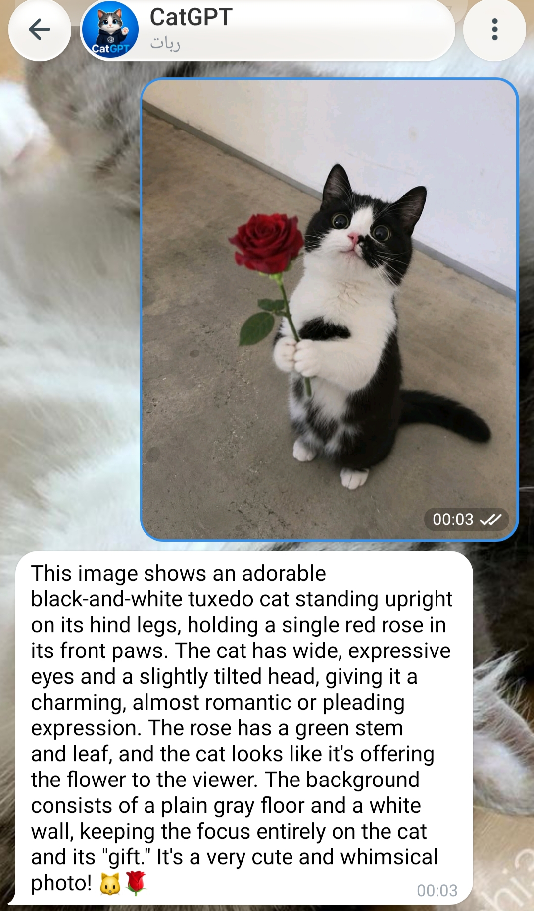

# CatGPT Telegram Bot

CatGPT is an English Telegram AI bot built with aiogram and the OpenAI Python SDK against the official OpenAI-compatible DeepSeek endpoint.

<p align="center">
  
</p>

## Server Deployment (Automated / Docker)

### Option 1: Quick Install via `install_server.sh` (Recommended)

Run the automated installer script on your Linux server (Ubuntu / Debian / CentOS / Rocky):

```bash
chmod +x install_server.sh
./install_server.sh
```

The script automatically:
1. Installs Docker & Docker Compose if missing.
2. Creates required directories (`logs`, `backups`) and initializes `catgpt.sqlite3`.
3. Interactively guides you through configuring `.env`.
4. Builds and starts the Docker container in the background.

#### Management Commands

```bash
./install_server.sh logs       # View real-time logs
./install_server.sh status     # Check container status & resource stats
./install_server.sh restart    # Restart the bot
./install_server.sh stop       # Stop the bot
./install_server.sh update     # Git pull + rebuild container
./install_server.sh backup     # Take a manual database backup
```

### Option 2: Docker Compose (Manual)

1. Copy `.env.example` to `.env` and fill in your keys:
   ```bash
   cp .env.example .env
   nano .env
   ```
2. Ensure database file and directories exist:
   ```bash
   mkdir -p logs backups
   touch catgpt.sqlite3
   ```
3. Build and launch with Docker Compose:
   ```bash
   docker compose up -d --build
   ```
4. View logs:
   ```bash
   docker compose logs -f
   ```

## Local Development Setup

1. Create a virtual environment:
   ```bash
   python -m venv .venv
   ```
2. Activate and install dependencies:
   ```bash
   # Windows PowerShell
   .venv\Scripts\Activate.ps1
   python -m pip install -r requirements.txt

   # Linux/macOS
   source .venv/bin/activate
   pip install -r requirements.txt
   ```
3. Copy `.env.example` to `.env` and fill in your real values.
4. Run the bot:
   ```bash
   python -m bot
   ```

## Features

- DeepSeek V4 Flash / Vision through `openai.AsyncOpenAI` for text chat over HTTP/2.
- Photo and image analysis support for vision-capable models (with configurable detail level).
- Configurable reasoning/thinking mode (`DEEPSEEK_THINKING_MODE` and `DEEPSEEK_THINKING_EFFORT`).
- Streaming via Telegram `sendMessageDraft`, with a final saved message and automatic splitting for long responses.
- Scoped conversation history: includes previous user/assistant turn; in groups, history is scoped by user and chat, and replying to a bot answer continues that specific answer's thread.
- Group support: when the bot is in a group, it answers replies to the bot or messages that mention the bot username, with optional welcome photo/message.
- Guest Mode support through Telegram `guest_message`; reply context is used when Telegram provides it.
- Free and Plus daily message limits reset at 00:00 UTC.
- Telegram Stars 30-day Plus subscription flow with automatic expiration notifications.
- Admin panel for live stats, user inspection (grant/revoke Plus, block/unblock), normal & forward broadcasts to users/groups, dynamic admin management, mandatory force join channels, bot pause/maintenance mode, and automated daily or on-demand database & log backups.

## Environment Variables

Create a `.env` file from `.env.example` and fill in the real values.

- `BOT_TOKEN`: Telegram bot token from BotFather (required)
- `DEEPSEEK_API_KEY`: API key for the DeepSeek/OpenAI-compatible endpoint (required)
- `DEEPSEEK_BASE_URL`: OpenAI-compatible API base URL (default: `https://api.deepseek.com`)
- `DEEPSEEK_MODEL`: model name used for chat completions (default: `deepseek-flash`)
- `DEEPSEEK_VISION_DETAIL`: image resolution detail level for vision models (`low`, `high`, `auto`, default: `low`)
- `DEEPSEEK_THINKING_MODE`: reasoning/thinking mode (`disabled` or `enabled`, default: `disabled`)
- `DEEPSEEK_THINKING_EFFORT`: reasoning effort level when thinking mode is enabled (`low`, `medium`, `high`, default: `low`)
- `ADMIN_IDS`: comma-separated Telegram user IDs for admin panel access
- `SUPPORT_URL`: support link shown in My Account, such as `admin_username` or `https://t.me/admin`
- `FREE_DAILY_LIMIT`: daily message limit for free users (default: `10`)
- `PLUS_DAILY_LIMIT`: daily message limit for Plus users and admins (default: `50`)
- `PLUS_STARS_PRICE`: Telegram Stars price for Plus subscription (default: `100`)
- `PLUS_PERIOD_SECONDS`: Plus subscription duration in seconds (default: `2592000` = 30 days)
- `MAX_INPUT_CHARS`: maximum user text length (default: `1000`)
- `MAX_OUTPUT_TOKENS`: maximum AI output tokens (default: `800`)
- `GROUP_WELCOME_PHOTO`: optional local path (e.g. `assets/catgptbot.png`) or Telegram file ID for the group welcome photo

## Commands
- `/start` start + register user
- `/account` account status
- Admin panel is shown to admins after `/start`

Group behavior:

- Slash commands are not executed in groups.
- In groups, CatGPT only answers normal text when the bot is mentioned or when a user replies to a bot message.
- Text that starts with `/` is ignored in groups, even if the bot is mentioned or replied to.

## Notes

- Keep real API keys in `.env`; do not commit them.
- Telegram chat wallpaper, bot avatar, and visual profile styling are configured through Telegram/BotFather or the client, not bot code.
- Tool calls are explicitly disabled with `tool_choice="none"`; no web search options or tools are sent to the API.
- Photo and vision analysis can be fine-tuned via `DEEPSEEK_VISION_DETAIL`.
- DeepSeek context caching is enabled by default by DeepSeek. CatGPT requests streamed usage data and logs `prompt_cache_hit_tokens` / `prompt_cache_miss_tokens` when DeepSeek returns them.
- The OpenAI SDK default timeout and retry behavior is used for DeepSeek requests.
